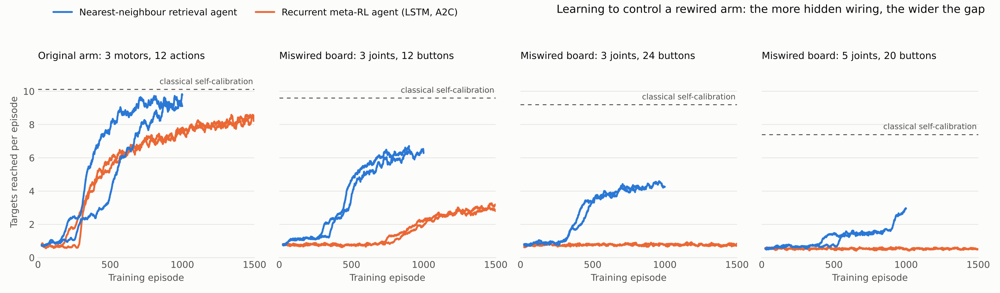
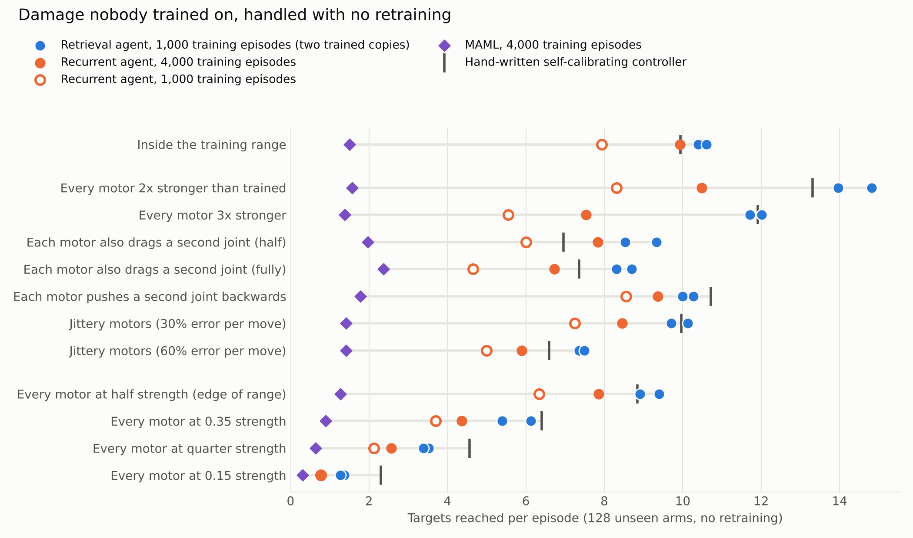

# Full results

The detailed write-up behind the short [README](../README.md): the task, the agent, every number, the caveats and the commands. Paths in the commands are relative to the repository root.

## The task

A planar arm with three joints and 12 discrete actions. Each episode is 150 steps; a target must be touched within 20
steps, then a new one appears. The agent sees the pen position, the target relative to the pen and the joint angles. It
never sees the wiring, which is drawn fresh for every episode:

| Variant | What is hidden |
|---|---|
| Original arm | which of 3 motors turns which joint, each motor's strength and direction, link lengths, sometimes a dead motor |
| Miswired board | for each of 12, 20 or 24 buttons: which joint it turns and by what signed step; some buttons are dead |

The score is the number of targets touched per episode. Three references need no learning: random actions, a classical
self-calibrating controller (try every action once, remember the pen displacement, then take the best predicted step),
and a one-step planner that is told the true wiring.

## The agent

`python/arm_meta.py`, in the order the code runs:

1. **Warm-up.** 300 episodes of random actions.
2. **Situation keys.** A small network maps (observation, action) to a 32-dimensional unit vector, trained with a
   contrastive loss so that transitions with the same effect in the same episode get similar keys. A learned gate per
   action drops observation features that do not matter for that action. The keys are then frozen.
3. **Episodic memory.** Every step of the current episode is stored as a row (action, gated observation before and
   after, reward) together with its frozen key. The memory is emptied when the episode ends.
4. **One hard nearest neighbor per action.** For each candidate action the agent finds the stored row with the highest
   cosine similarity to that action's key and adds that row's observed effect to the action's latent: `z_hat = z + delta`.
   There is no soft attention over keys and no averaging.
5. **A transformer over the memory rows**, one layer, mean pooled, as the episode summary.
6. **Plain n-step A2C** (16 parallel arms, 20-step updates, policy + value + entropy losses, no auxiliary loss).

`--no-nn` switches step 4 off and leaves everything else in place.

The baseline, `python/arm_rl2.py`, is a standard recurrent meta-RL agent in the style of RL² (Duan et al. 2016; Wang
et al. 2016): an LSTM that receives the observation, its previous action and the previous reward, trained with the same
A2C loss on the same arms.

## Results



Targets touched per episode on arms never seen in training. The retrieval agent trained for 1,000 episodes, the
recurrent agent for 1,500. Each number is one training run.

| Variant | Retrieval agent | Recurrent agent | Retrieval starts learning | Recurrent starts learning | Classical | Told the wiring |
|---|---|---|---|---|---|---|
| Original arm | 9.2, 9.5, 10.7 | about 8.3 | episode 150 to 300 | episode 100 to 250 | 10.1 | 21.8 |
| Board, 3 joints, 12 buttons | 6.3, 6.3, 6.7\* | 2.8, 3.2 | about 350 | about 900 | 9.6 | 17.5 |
| Board, 3 joints, 24 buttons | 4.5, 4.2\* | 0.8, 0.7 | about 350 | about 2,300 | 9.2 | 21.7 |
| Board, 5 joints, 20 buttons | 3.2, 1.6\* | 0.7, 0.5 | about 550 | not within 1,500 | 7.4 | 19.3 |

\* That run stopped at episode 825 to 900 when the machine restarted; the figure is its training average at that
point, not a held-out score.

- Without retrieval (`--no-nn`) the same agent stays at the random score (0.9, 1.0) for all 1,000 episodes on the
  original arm.
- On the original arm the recurrent agent needs about 3,000 episodes to reach what the retrieval agent has at 1,000.
- On the 24-button board the recurrent agent ends at 2.7 after 6,000 episodes. The retrieval agent passes that at about
  episode 430.

### Damage nobody trained on



In training every motor has a strength between 0.5 and 1.5, turns exactly one joint and moves exactly as commanded.
Here the agents meet arms outside that range. Nobody is retrained: each agent has only its 150-step episode to cope.
Targets touched per episode on 128 arms per row.

| Damage | Retrieval agent, 1,000 episodes (two trained copies) | Recurrent agent, 4,000 episodes | Recurrent agent, 1,000 episodes | MAML, 4,000 episodes | Classical |
|---|---|---|---|---|---|
| Inside the training range | 10.4, 10.6 | 9.9 | 7.9 | 1.5 | 9.9 |
| Every motor 2x stronger than trained | 14.0, 14.8 | 10.5 | 8.3 | 1.6 | 13.3 |
| Every motor 3x stronger | 11.7, 12.0 | 7.5 | 5.5 | 1.4 | 11.9 |
| Each motor also drags the next joint by half its move | 8.5, 9.3 | 7.8 | 6.0 | 2.0 | 7.0 |
| Each motor also drags the next joint by its full move | 8.3, 8.7 | 6.7 | 4.7 | 2.4 | 7.4 |
| Each motor pushes the next joint backwards | 10.0, 10.3 | 9.4 | 8.6 | 1.8 | 10.7 |
| Jittery motors, 30% random error per move | 9.7, 10.1 | 8.5 | 7.2 | 1.4 | 10.0 |
| Jittery motors, 60% random error per move | 7.4, 7.5 | 5.9 | 5.0 | 1.4 | 6.6 |
| Every motor at half strength (edge of the range) | 9.4, 8.9 | 7.9 | 6.3 | 1.3 | 8.8 |
| Every motor at 0.35 strength | 5.4, 6.1 | 4.4 | 3.7 | 0.9 | 6.4 |
| Every motor at quarter strength | 3.5, 3.4 | 2.6 | 2.1 | 0.6 | 4.6 |
| Every motor at 0.15 strength | 1.4, 1.3 | 0.8 | 0.8 | 0.3 | 2.3 |

- The recurrent agent with four times the training matches the retrieval agent inside the range and falls behind
  outside it.
- MAML (its best setting without practice episodes, see below) never gets going, inside the range or outside it.
- The retrieval agent is level with or ahead of the hand-written controller on stronger motors, crosstalk in the
  forward direction and heavy jitter. It is behind on weak motors and on reverse crosstalk.
- In this table both learned agents pick actions at temperature 0.25 instead of the training temperature of 1. That
  helped both; the temperature-1 numbers are in `unseen-damage/*-temp1.json`. The Results table above uses
  temperature 1.
- Training further does not help. Continuing A2C on the trained retrieval agent with one unseen arm changed nothing in
  100 episodes (1.3 to 1.5 targets on one arm, 3.0 to 2.7 on another) and lowered its score on random arms.
- A plain recurrent agent trained from scratch on a single damaged arm does get there (3.7 and 9.0 targets after 500
  episodes on those two arms, classical 3.8 and 6.1), at the price of about 500 episodes per new fault.

### MAML

`python/arm_maml.py` is a MAML baseline (Finn et al. 2017) with learned step sizes (Meta-SGD): a feed-forward
actor-critic with no memory that adapts to an arm by taking A2C gradient steps on its own weights inside the episode.
Meta-training backpropagates through those steps. Held-out targets per episode after 4,000 training episodes, one run
each (64 arm-episodes per figure, so differences of a few tenths are noise):

| Setting | Targets per episode |
|---|---|
| Step size 0.05, a gradient step every 25 moves | 1.7 |
| Step size 0.5, every 25 moves | 1.0 |
| Step size 0.2, every 10 moves | 0.5 |
| First-order (no second derivatives, close to Reptile), 0.05, every 25 moves | 1.7 |
| One unscored practice episode on each arm first, 0.05, every 25 moves | 0.7 |
| Two unscored practice episodes on each arm first, 0.05, every 50 moves | 2.3 |
| The same network with no gradient steps at all | 2.5 |
| Random actions | about 0.9 |
| Recurrent agent, 4,000 episodes | 10.0 |
| Retrieval agent, 1,000 episodes | 9.2 to 10.7 |

No setting of the gradient steps did better than leaving them out, and all of them are far below the two agents that
keep what they see. The practice-episode rows are the original MAML setup and give it two to three times the
experience on each arm that the other agents get. This is our own implementation with six settings tried and an A2C
inner loss; a better-tuned MAML (TRPO outer loop, larger inner batches) might do better, and we did not find one. Our
reading, which these runs do not test: an arm's wiring is a handful of exact facts, a gradient step estimated from 25
to 150 noisy moves is a poor place to write them, and memory or a hidden state stores them directly.

### What these results do not show

- **It does not clearly beat classical control.** At the training temperature the hand-written self-calibrating
  controller scores higher than the learned agent on every variant. With the more decisive action choice the learned
  agent is level with it on the original arm and ahead on some unseen damage, and still well behind on the miswired
  boards and on weak motors. The claims are about how fast a learned agent acquires the skill and how it holds up on
  unseen damage, compared with another learned agent.
- **Two baselines.** The comparison is against one recurrent architecture with two hyperparameter settings (the
  better one is reported) and one MAML implementation with six settings. Transformer-based meta-RL agents and other
  episodic-memory agents were not run.
- **Compute.** One training episode of the retrieval agent costs roughly 7 to 12 times more CPU time than one of the
  recurrent agent (about 2.5 s against 0.35 s on one core). The comparison above is in episodes, not seconds.
- **Task selection.** The miswired board was added after the first comparison on the original arm came out close
  (about 3x). The original arm is reported alongside it for that reason.
- **Unseen damage was tested narrowly.** One recurrent run and two retrieval runs, on the original arm only, with
  three kinds of damage chosen by us.
- **Small scale.** A 2D kinematic arm with stepper-style actions, two seeds, no hardware.

## Reproduce

```bash
pip install -r python/requirements.txt

# reference scores for a variant
python python/arm_env.py
ARM_WIRING=board ARM_BUTTONS=24 python python/arm_env.py

# the retrieval agent: warm-up, key pretraining, then 1,000 episodes (about 1 hour on one CPU core)
python python/arm_meta.py runs/original
python python/arm_meta.py runs/original-no-retrieval --no-nn --keys runs/original/keys.pt
ARM_WIRING=board ARM_BUTTONS=24 python python/arm_meta.py runs/board24

# the recurrent baseline (about 6 minutes per 1,000 episodes)
ARM_WIRING=board ARM_BUTTONS=24 python python/arm_rl2.py runs/board24-recurrent --episodes 1500 --gamma 0.9 --entropy 0.01

# the recurrent baseline trained until it matches the retrieval agent inside the training range
python python/arm_rl2.py runs/original-recurrent --episodes 4000 --gamma 0.9 --entropy 0.01

# MAML: gradient steps inside the episode (about 50 minutes; --first-order, --practice 2 and --no-adapt are the other rows)
python python/arm_maml.py runs/original-maml --episodes 4000 --alpha 0.05 --adapt-every 25

# unseen damage, no retraining (add --temp 1 for the training temperature)
python python/arm_ood.py refs --seeds 31000 32000
python python/arm_ood.py ours runs/original runs/original/keys.pt --temp 0.25 --seeds 31000 32000
python python/arm_ood.py rl2 runs/original-recurrent/model.pt --temp 0.25 --seeds 31000 32000
python python/arm_ood.py maml runs/original-maml/model-4000.pt --temp 0.25 --seeds 31000 32000
python python/arm_finetune.py runs/original runs/original/keys.pt runs/keep-training weak-motors

# redraw the charts from the logs in results/
python python/plot_results.py results/harder_arms.png
python python/plot_ood.py results/unseen-damage results/unseen_damage.png

# export a trained agent for the page and check the JavaScript port against PyTorch
python python/export_web.py runs/original runs/original/keys.pt motors3 web/weights
python python/export_rl2.py runs/original-recurrent/model.pt recurrent3 web/weights 4000
node web/check_agent.js motors3     # logits agree to about 1e-5
node web/check_recurrent.js         # the recurrent baseline's port, same check
node web/check_scores.js 40 0.25    # every driver's score in the JavaScript simulator
node web/check_unseen.js            # unseen damage in the JavaScript simulator
node web/check_writing.js           # the page's writing task along both sliders
```

`results/` holds the per-episode logs behind every number above.

## Related work

- Duan et al., *RL²: Fast Reinforcement Learning via Slow Reinforcement Learning*, 2016, and Wang et al., *Learning to
  reinforcement learn*, 2016: recurrent meta-RL, the baseline here.
- Finn et al., *Model-Agnostic Meta-Learning for Fast Adaptation of Deep Networks*, 2017, Li et al., *Meta-SGD*, 2017,
  and Nichol et al., *On First-Order Meta-Learning Algorithms*, 2018 (Reptile): adaptation by gradient steps, the second
  baseline here.
- Pritzel et al., *Neural Episodic Control*, 2017: nearest-neighbor lookup of values in an episodic memory.
- Ritter et al., *Rapid Task-Solving in Novel Environments*, 2020: the Episodic Planning Network, self-attention over
  an episodic memory; the transformer over memory rows here follows it.
- Wang et al., *Alchemy: A benchmark and analysis toolkit for meta-reinforcement learning agents*, 2021: the benchmark
  this agent was first developed on.
- Cully et al., *Robots that can adapt like animals*, 2015, and Kumar et al., *RMA: Rapid Motor Adaptation for Legged
  Robots*, 2021: adapting to damage and changed dynamics on real robots, far beyond the scale of this demo.

## License

MIT, see `LICENSE`.
